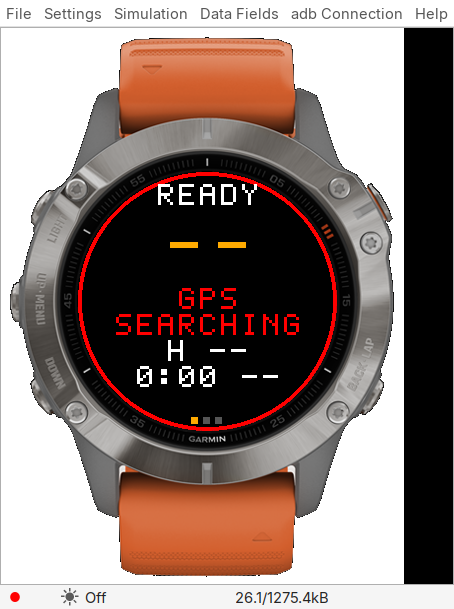
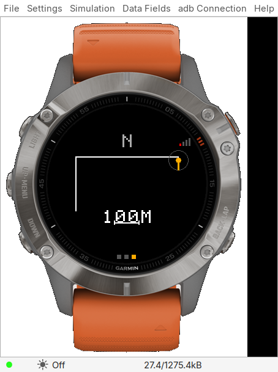
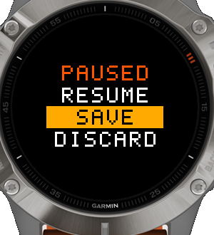
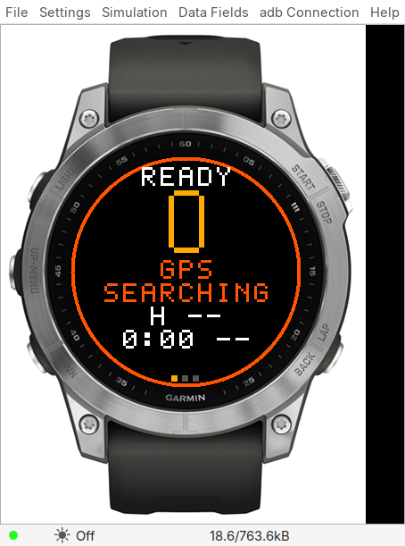
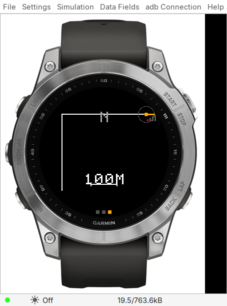

# MX Ride

Watch app for motocross and desert riding. Version 1.0.4. The big number is speed in km/h. Under it: heading, altitude, heart rate, timer, and distance. DOWN opens max speed and laps, then a north-up track of the ride.

Tested in the Connect IQ 9.3.0 simulator on a fēnix 6 Pro and a fēnix 7, both 260 px. Built for every fēnix 6, 7, 8, and 9 product id in that SDK, plus fēnix E. The 416, 454, and 466 faces have no simulator skin in this environment, so they were compiled and laid out, not screenshotted.















## Devices

fēnix 6 family, including Solar and Dual Power. Those share the five product ids. There is no separate `fenix6x` id.

| Watch | Product id | Screen |
| --- | --- | --- |
| fēnix 6, 6 Solar, 6 Dual Power | `fenix6` | 260 MIP |
| fēnix 6S, 6S Solar, 6S Dual Power | `fenix6s` | 240 MIP |
| fēnix 6 Pro, 6 Pro Solar, 6 Pro Dual Power | `fenix6pro` | 260 MIP |
| fēnix 6S Pro, 6S Pro Solar, 6S Pro Dual Power | `fenix6spro` | 240 MIP |
| fēnix 6X Pro, 6X Pro Solar | `fenix6xpro` | 280 MIP |

fēnix 7 family. 7 Pro and the no-Wi-Fi variants were already in 1.0.3. Solar is not a separate id. fēnix 7X is also Enduro 2 and tactix 7.

| Watch | Product id | Screen |
| --- | --- | --- |
| fēnix 7 | `fenix7` | 260 MIP |
| fēnix 7S | `fenix7s` | 240 MIP |
| fēnix 7X | `fenix7x` | 280 MIP |
| fēnix 7 Pro | `fenix7pro` | 260 MIP |
| fēnix 7S Pro | `fenix7spro` | 240 MIP |
| fēnix 7X Pro | `fenix7xpro` | 280 MIP |
| fēnix 7 Pro, no Wi-Fi | `fenix7pronowifi` | 260 MIP |
| fēnix 7X Pro, no Wi-Fi | `fenix7xpronowifi` | 280 MIP |

fēnix 8, fēnix E, and fēnix 9. These ids are in SDK 9.3.0 `devices.xml`. The SDK manager will not download the device pack without a Garmin developer login, so `scripts/import-sdk-devices.py` writes `compiler.json` from that XML. It does not copy another watch's `.bin`. A later official download is left alone.

| Watch | Product id | Screen |
| --- | --- | --- |
| fēnix 8 43mm | `fenix843mm` | 416 AMOLED |
| fēnix 8 47mm / 51mm, tactix 8 47/51, quatix 8 47/51 | `fenix847mm` | 454 AMOLED |
| fēnix 8 Pro 47/51, MicroLED, quatix 8 Pro | `fenix8pro47mm` | 454 AMOLED |
| fēnix 8 Solar 47mm | `fenix8solar47mm` | 260 MIP |
| fēnix 8 Solar 51mm, tactix 8 Solar 51mm | `fenix8solar51mm` | 280 MIP |
| fēnix E | `fenixe` | 416 AMOLED |
| fēnix 9 43mm | `fenix943mm` | 416 AMOLED |
| fēnix 9 47mm / 51mm | `fenix947mm` | 454 AMOLED |
| fēnix 9 Pro 43mm | `fenix9pro43mm` | 416 AMOLED |
| fēnix 9 Pro 47mm | `fenix9pro47mm` | 454 AMOLED |
| fēnix 9 Pro 51mm | `fenix9pro51mm` | 466 AMOLED |
| fēnix 9 Pro Solar 47mm | `fenix9prosolar47mm` | 260 MIP |
| fēnix 9 Pro Solar 51mm | `fenix9prosolar51mm` | 280 MIP |

240, 260, and 280 keep the top-weighted stack from 1.0.3. On 416, 454, and 466 the same block is centered, the track box is inset so the corners stay inside the circle, and the GPS ring is a 3 px stroke set in from the bezel. The background stays black. There is no solid white panel. The yellow SAVE bar is only on the save screen.

fēnix 6 and 6S have a 128 KB watch-app limit. That limit is code plus data, not the `.prg` file size. A release build of this tree is 23308 bytes on disk for fēnix 6, with 11519 bytes of code and 1848 bytes of data (13367 total, 10.2% of 131072). The same flags produce a 17852 byte fēnix 7 `.prg` (8675 code and 2026 data, 10701 total). An unstripped build is about 126 KB because it embeds the Connect IQ symbol table, and that table is not what the limit counts. Pro and 6X Pro have 1.25 MB. fēnix 7 and the newer AMOLED parts have 768 KB.

## Build

Connect IQ SDK 9.3.0. `monkeyc` must be on `PATH`, or set `CIQ_SDK` to the SDK root. Device definitions go in `~/.Garmin/ConnectIQ/Devices`.

The SDK zip does not need a Garmin login. The SDK manager's device download does. The fēnix 6 and 7 folders used here came from [berryk/Garmin-watchface `devices-v1.0.0`](https://github.com/berryk/Garmin-watchface/releases/download/devices-v1.0.0/connectiq-devices.zip). Unpack it so these folders sit next to each other:

`fenix6` `fenix6s` `fenix6pro` `fenix6spro` `fenix6xpro` `fenix7` `fenix7s` `fenix7x` `fenix7pro` `fenix7spro` `fenix7xpro` `fenix7pronowifi` `fenix7xpronowifi`

The build script then writes compiler profiles for the 8, E, and 9 ids from the SDK jar.

```
./scripts/build.sh
```

That passes `-r` and `-O 2` to every `monkeyc` invocation, including the `--public` package. `-r` strips the symbol table. `-O 2` is the compiler's fast optimizer. `./scripts/build.sh --debug` leaves both off and matches the older unstripped build. `--public` and `--debug` can be combined.

Outputs `bin/mxride-<device>.prg` for every id in the tables above, plus `bin/mxride.iq`. That package keeps the beta app id `A7C3E91B4D2F4A6E8B1C0D5E7F908172`.

Garmin will not take a beta app public. The public listing is a second app, same version and devices, app id `8C03D4377798050D9445D7B0820FB52A`, same signing key.

```
./scripts/build.sh --public
```

That writes `bin/mxride-public.iq` from `manifest-public.xml`. It does not rebuild the beta `.prg` files or `bin/mxride.iq`. The two manifests must match except for the app id, and the script refuses to build when they do not.

The first run mints `bin/developer_key.der` with openssl when that file is missing. The key and `bin/developer_key.pem` are gitignored. Builds (`bin/*.prg` and `bin/*.iq`) are not tracked in git either: run `./scripts/build.sh` locally, or grab a signed binary from the [GitHub Releases page](https://github.com/drvillo/mxride/releases). The released `.prg` files were signed with a key that is not in this repo. To reproduce the same signatures locally you need that key; a different key is a different signature, so remove the old sideload from the watch before installing a locally built one.

## Sideload

Run `./scripts/build.sh` first, or download a prebuilt `.prg` from [GitHub Releases](https://github.com/drvillo/mxride/releases).

Plug the watch in over USB. Copy the `.prg` that matches the product into `GARMIN/APPS` on the watch drive. Eject, then start MX Ride from the app list.

`bin/mxride.iq` is the beta package. `bin/mxride-public.iq` is the public store package. USB sideload uses the `.prg`, which is the beta app.

## Buttons

Physical buttons. Touch is not the control.

| Button | Action |
| --- | --- |
| START, short | Ready: start. Recording: pause. Paused: open the save screen. Save screen: accept the highlighted row. |
| START, long, or hold UP (MENU) | Open the save screen. A recording pauses once on the way in. |
| UP / DOWN | Switch the three pages. On the save screen, move through RESUME, SAVE, and DISCARD. |
| BACK | Recording or paused: lap. Save screen: back to paused. Ready: leave the app. |

The save screen lists RESUME, SAVE, DISCARD. SAVE is highlighted when it opens. While paused, the ride page shows `START: SAVE` in place of the heading, and the stats page shows it in place of the ascent line.

Page 1 is speed in km/h, heading in degrees plus a cardinal and a needle, `A` for altitude in meters, `H` for heart rate, then the timer and distance in km.

Page 2 is `MAX` speed, `UP` for total ascent in meters, the current lap time, and the lap count.

Page 3 is the track. It is a north-up line of the ride so far, scaled to the current position, with a heading arrow and a scale bar. Map tiles are not used. fēnix 6 and fēnix 6S have no map view, so every device draws the line itself. The line keeps at most 96 points and drops every other point once it fills, so a long ride stays a coarse shape of the whole loop.

Before the ride starts, the ready screen draws a ring and `GPS` / `SEARCHING` in red until there is a poor fix, then orange, then `GPS` / `READY` in green once accuracy is usable or good. The label font cannot fit `GPS SEARCHING` on one line of a 240 face, so the two words are stacked. A short vibration fires the first time the ready screen reaches that fix. START still begins a ride with no fix. While recording or paused, four bars sit on the upper right of every page: grey for no fix, one red bar for poor, two yellow bars for usable, four green bars for good.

Missing GPS or heart rate draws `--`. Speed stays `--` until there is a fix. A zero is not used as a stand-in.

## What is recorded

The session is sport motorcycling, name Motocross. On Connect IQ 4.1.6 and later the subsport is motocross. fēnix 6 is API 3.4, which has no motocross subsport, so that field is left off and the sport stays motorcycling. The FIT gets the GPS track, speed, distance, elevation, ascent, timer, laps, heart rate when the watch has a reading, and the device's own calorie figure. Two developer fields, both in km/h: `max_speed` on the session, `lap_max_speed` on each lap.

GPS is turned on when the app opens and stays on through pause, page changes, and save. It turns off only when the app exits. The call is `enableLocationEvents` with a continuous fix. SatIQ is requested only when `hasConfigurationSupport` says the watch has that configuration. fēnix 6 does not advertise SatIQ, so it takes the continuous path. The app does not pin multi-band max accuracy. A record is written either way, but latitude and longitude are filled in only while the watch has a fix. An indoor ride syncs an activity and Connect has nothing to draw a map from. `createSession` does not expose the recording interval, so 1 Hz versus smart recording stays with the device. The calorie number is the device algorithm. On a motorcycling activity that can be a poor estimate, because the bike is doing the work.

## Fonts

The official Connect IQ font pack returned HTTP 401 without a Garmin developer login. Asking the simulator for a missing system font crashes the app. MX Ride ships its own bitmap fonts in `resources/fonts`: a large 7-segment digit face and a smaller label face. `scripts/gen_fonts.py` regenerates both, plus the launcher icon at 40 px, 60 px (416 faces), and 65 px (454 and 466 faces). Labels stay uppercase. That face has no lowercase and no degree sign.

## Simulator

`sim/desert-loop.gpx` is a two-minute rectangle at 50 km/h. On the fēnix 6 Pro and the fēnix 7, playback showed 50 km/h, a heading, a running timer, and distance. The track page drew the north-up line, an `N`, and a `100M` scale. The same run reported altitude near -450 m and no heart rate. This simulator did not apply the file's elevation or its heart-rate extension. The app drew the numbers the simulator supplied.

The simulator never reported a usable or good fix. With the file playing, the ring and the `GPS` / `SEARCHING` line stayed orange and the bars showed one red bar. The green `GPS READY` state is in the code and was not screenshotted. The no-fix ready screen is the red ring.

The 240 and 280 faces share the 1.0.3 layout and were compiled, not screenshotted. The 416, 454, and 466 faces were compiled with the centered layout. There is no skin for those devices in the installed pack.
