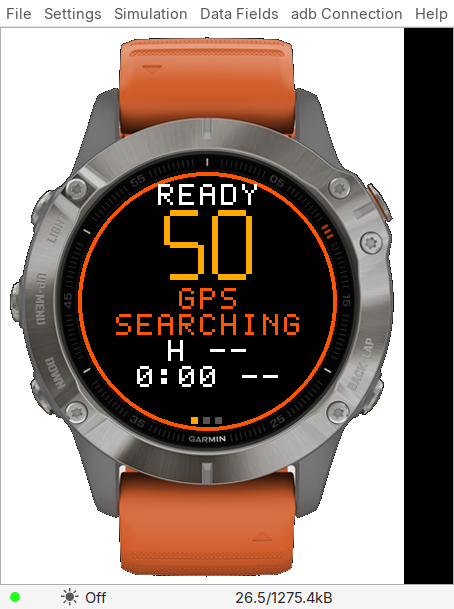
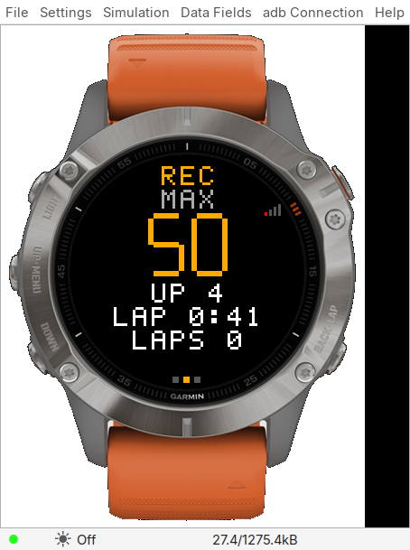
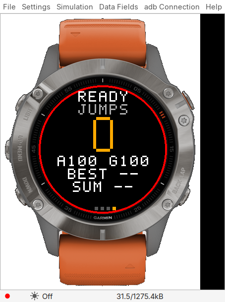
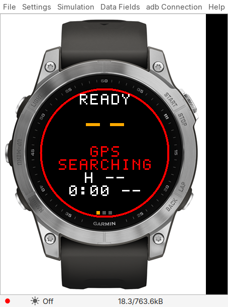
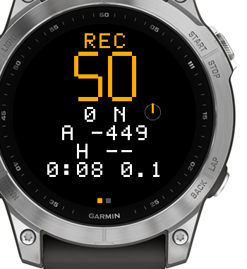
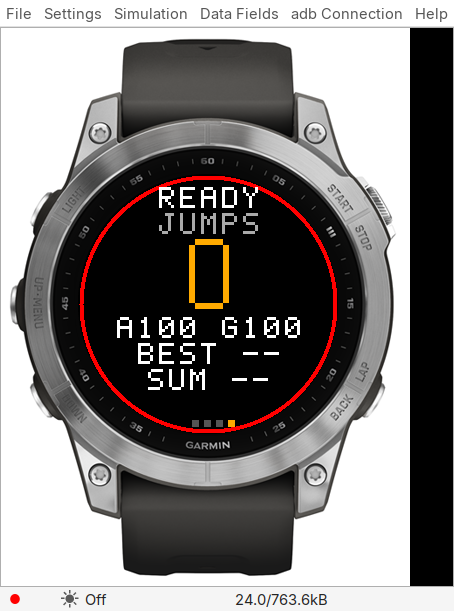
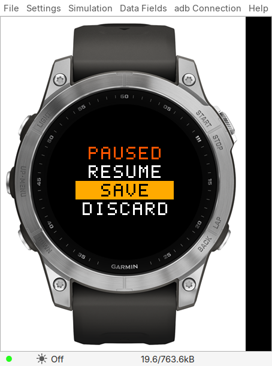

# MX Ride

Watch app for motocross and desert riding. Version 1.0.6. The big number is speed in km/h. A G-ring wraps every edge of the ride page: green clockwise from 12 for compression and landings, red counter-clockwise for unloading and free fall, with a 3 s peak-hold tick and a thin yellow inner arc for cornering / braking direction. DOWN opens max speed, heading and altitude, then a north-up track, then jump count and air time.

1.0.6 is three things stacked on 1.0.5: a G-ring on the ride page, per-second G capture in the FIT file, and Garmin Connect labels for every developer field, new and old.

- **G-ring and the new G line.** The ring value is `vertical load − 1 g`, peak-of-second. Positive side (green) covers 30 segments × 0.1 g up to +3 g. Negative side (red) covers 30 segments × 0.033 g down to −1 g (free fall). A white tick on each side holds the highest value of the last 3 s. The thin yellow inner arc points where the horizontal G is felt — right turn at 3 o'clock, braking at 12, acceleration at 6 — with arc length growing with magnitude. The ride-page center now ends on a G line: `0.4 G` for the current ring value, `LAND 2.9` for 3 s after a landing-window peak, `AIR 0.6` live during a jump. Heading and altitude moved to the Stats page.
- **New G fields in the FIT file.** Record fields (per second): `g_vert` (id 12), `g_lat` (id 10), `g_lon` (id 11), each a signed float in g. Session maxima: `max_land_g` (13), `max_corner_g` (14), `max_brake_g` (15), `max_accel_g` (16), `max_combined_g` (17), `imu_ok_pct` (18, a 0–100 share of samples where the gravity filter was converged). Lap maxima repeat the first four as 19–22. All floats record at `precision="2"`. Record new fields total 12 bytes, session new fields 21 bytes, lap new fields 16 bytes; every FIT message is well under the 256-byte-per-message developer-fields limit.
- **Garmin Connect labels.** `resources/fitContributions.xml` names every developer field so Connect shows "Max speed", "Lap max speed", "Jumps", "Air time", "Longest air", "Recent airs", "Last air", "Vertical G", "Lateral G", "Longitudinal G", "Max landing G", "Max cornering G", "Max braking G", "Max acceleration G", "Max combined G", "IMU convergence", each with its unit (km/h, ms, count, g, %). The three per-second G fields and the existing `jump_last_ms` are also plotted on the activity's per-record chart.

Existing field ids 0–9 and the FIT output for them are byte-for-byte unchanged. Both the beta app id `A7C3E91B4D2F4A6E8B1C0D5E7F908172` and the public app id `97044CB1ADC84D52B353125C4B120D7D` are the same as 1.0.5.

Tested in the Connect IQ 9.3.0 simulator on a fēnix 6 Pro and a fēnix 7, both 260 px. Built for every fēnix 6, 7, 8, and 9 product id in that SDK, plus fēnix E. The 416, 454, and 466 faces have no simulator skin in this environment, so they were compiled and laid out, not screenshotted.





















## Devices

fēnix 6 family, including Solar and Dual Power. Those share the five product ids. There is no separate `fenix6x` id.

| Watch | Product id | Screen |
| --- | --- | --- |
| fēnix 6, 6 Solar, 6 Dual Power | `fenix6` | 260 MIP |
| fēnix 6S, 6S Solar, 6S Dual Power | `fenix6s` | 240 MIP |
| fēnix 6 Pro, 6 Pro Solar, 6 Pro Dual Power | `fenix6pro` | 260 MIP |
| fēnix 6S Pro, 6S Pro Solar, 6S Pro Dual Power | `fenix6spro` | 240 MIP |
| fēnix 6X Pro, 6X Pro Solar | `fenix6xpro` | 280 MIP |

fēnix 7 family. 7 Pro and the no-Wi-Fi variants were already in 1.0.3. Solar is not a separate id. fēnix 7X is also Enduro 2 and tactix 7.

| Watch | Product id | Screen |
| --- | --- | --- |
| fēnix 7 | `fenix7` | 260 MIP |
| fēnix 7S | `fenix7s` | 240 MIP |
| fēnix 7X | `fenix7x` | 280 MIP |
| fēnix 7 Pro | `fenix7pro` | 260 MIP |
| fēnix 7S Pro | `fenix7spro` | 240 MIP |
| fēnix 7X Pro | `fenix7xpro` | 280 MIP |
| fēnix 7 Pro, no Wi-Fi | `fenix7pronowifi` | 260 MIP |
| fēnix 7X Pro, no Wi-Fi | `fenix7xpronowifi` | 280 MIP |

fēnix 8, fēnix E, and fēnix 9. These ids are in SDK 9.3.0 `devices.xml`. The SDK manager will not download the device pack without a Garmin developer login, so `scripts/import-sdk-devices.py` writes `compiler.json` from that XML. It does not copy another watch's `.bin`. A later official download is left alone.

| Watch | Product id | Screen |
| --- | --- | --- |
| fēnix 8 43mm | `fenix843mm` | 416 AMOLED |
| fēnix 8 47mm / 51mm, tactix 8 47/51, quatix 8 47/51 | `fenix847mm` | 454 AMOLED |
| fēnix 8 Pro 47/51, MicroLED, quatix 8 Pro | `fenix8pro47mm` | 454 AMOLED |
| fēnix 8 Solar 47mm | `fenix8solar47mm` | 260 MIP |
| fēnix 8 Solar 51mm, tactix 8 Solar 51mm | `fenix8solar51mm` | 280 MIP |
| fēnix E | `fenixe` | 416 AMOLED |
| fēnix 9 43mm | `fenix943mm` | 416 AMOLED |
| fēnix 9 47mm / 51mm | `fenix947mm` | 454 AMOLED |
| fēnix 9 Pro 43mm | `fenix9pro43mm` | 416 AMOLED |
| fēnix 9 Pro 47mm | `fenix9pro47mm` | 454 AMOLED |
| fēnix 9 Pro 51mm | `fenix9pro51mm` | 466 AMOLED |
| fēnix 9 Pro Solar 47mm | `fenix9prosolar47mm` | 260 MIP |
| fēnix 9 Pro Solar 51mm | `fenix9prosolar51mm` | 280 MIP |

240, 260, and 280 keep the top-weighted stack from 1.0.3. On 416, 454, and 466 the same block is centered, the track box is inset so the corners stay inside the circle, and the GPS ring is a 3 px stroke set in from the bezel. The background stays black. There is no solid white panel. The yellow SAVE bar is only on the save screen.

fēnix 6 and 6S have a 128 KB watch-app limit. That limit is code plus data, not the `.prg` file size. A release build of 1.0.6 is 41516 bytes on disk for fēnix 6, with 26788 bytes of code and 4215 bytes of data (31003 total, 23.65% of 131072). The G-ring and the sensing module add about 8.8 KB of code and 1.3 KB of data over 1.0.5; the stripped `.prg` on disk grew by about 10.6 KB. Still leaves 100 KB of headroom on the base fēnix 6. An unstripped build is larger because it embeds the Connect IQ symbol table, and that table is not what the limit counts. Pro and 6X Pro have 1.25 MB. fēnix 7 and the newer AMOLED parts have 768 KB.

## Build

Connect IQ SDK 9.3.0. `monkeyc` must be on `PATH`, or set `CIQ_SDK` to the SDK root. Device definitions go in `~/.Garmin/ConnectIQ/Devices`.

The SDK zip does not need a Garmin login. The SDK manager's device download does. The fēnix 6 and 7 folders used here came from [berryk/Garmin-watchface `devices-v1.0.0`](https://github.com/berryk/Garmin-watchface/releases/download/devices-v1.0.0/connectiq-devices.zip). Unpack it so these folders sit next to each other:

`fenix6` `fenix6s` `fenix6pro` `fenix6spro` `fenix6xpro` `fenix7` `fenix7s` `fenix7x` `fenix7pro` `fenix7spro` `fenix7xpro` `fenix7pronowifi` `fenix7xpronowifi`

The build script then writes compiler profiles for the 8, E, and 9 ids from the SDK jar.

```
./scripts/build.sh
```

That passes `-r` and `-O 2` to every `monkeyc` invocation, including the `--public` package. `-r` strips the symbol table. `-O 2` is the compiler's fast optimizer. `./scripts/build.sh --debug` leaves both off and matches the older unstripped build. `--public` and `--debug` can be combined. `--generate-key` creates `bin/developer_key.der` only when that file and `bin/developer_key.pem` are both absent. A build with no key stops. It does not write a new key on its own, and `--generate-key` will not replace one that is already there.

Outputs `bin/mxride-<device>.prg` for every id in the tables above, plus `bin/mxride.iq`. That package keeps the beta app id `A7C3E91B4D2F4A6E8B1C0D5E7F908172`.

Garmin will not take a beta app public. The public listing is a new app, same name (MX Ride), version, and devices, app id `97044CB1ADC84D52B353125C4B120D7D`. The beta id `A7C3E91B4D2F4A6E8B1C0D5E7F908172` was signed with a developer key that is gone, so that store listing cannot take a 1.0.6 update. 1.0.6, beta and public, is signed with the key in `bin/developer_key.der`.

To produce the signed public store package with a given key file:

```
cp /path/to/release/private.der bin/developer_key.der
./scripts/build.sh --public
# writes bin/mxride-public.iq
```

The script reads the key from `bin/developer_key.der`. It never creates one unless you pass `--generate-key`, and it refuses to overwrite one that is already there. `./scripts/build.sh --public` writes `bin/mxride-public.iq` from `manifest-public.xml`. It does not rebuild the beta `.prg` files or `bin/mxride.iq`. The two manifests must match except for the app id, and the script refuses to build when they do not.

`bin/developer_key.der` and `bin/developer_key.pem` are gitignored and are not created during a normal build. Builds (`bin/*.prg` and `bin/*.iq`) are not tracked in git either: run `./scripts/build.sh` locally, or grab a signed binary from the [GitHub Releases page](https://github.com/drvillo/mxride/releases). The 1.0.4 releases were signed with a different key. A 1.0.6 package will not update those listings.

## G-ring and continuous G

The ride page draws a 30-segment ring on each half, around the full bezel. Each segment is 0.1 g wide on the green (compression) side and 0.033 g on the red (unloading) side, so the two halves cover +3 g and −1 g respectively. The ring updates at 1 Hz — sensor batches arrive once per second, so the ring always shows the *last* second, which is also when the FIT record for that second is written.

The center text is the ring's driving value, in g, with one decimal. Live overrides: during an in-progress jump the line reads `AIR 0.6`, the live air-time timer; for 3 s after a landing-window peak it reads `LAND 2.9`, the max |a| the wrist saw inside the 500 ms window right after the accepted jump. After those 3 s it falls back to the ring value.

The thin yellow inner arc is the direction of horizontal G. Convention is felt-force: a right turn pushes the body right, so the arc parks at 3 o'clock; braking pushes the body forward, so the arc parks at 12; acceleration at 6 o'clock. Arc length grows with the horizontal G magnitude (1.5 g = ±45°, capped at ±60°).

Sensing uses the wrist accelerometer and, when the watch has one, the gyro. A gravity vector in watch coordinates is rotated by the gyro each sample and nudged toward the measured accel at τ ≈ 2 s. Without a gyro the same vector is low-passed against the accel at τ ≈ 3 s. The nudge is frozen while `|a|` is more than ~0.3 g off 1 g, so landings, air and hard turns do not wash the estimate. Vertical load is the signed projection of `a` on that gravity vector. Horizontal is `a − (a·ĝ)ĝ`. Cornering G is yaw-rate × GPS speed when the gyro is available and speed is at least 10 km/h; otherwise the ring still works but the inner arc is driven by GPS alone. Braking / acceleration G is GPS `dv/dt`. See `source/Gforce.mc` for the per-sample loop and `scripts/gforce.py` for a Python mirror. `python3 scripts/gforce_harness.py` runs seven synthetic cases against both.

Known limits for 1.0.6, since there was no ride test before release:

- Cornering G is leaned-bike geometry: a wrist on top of the bars feels extra compression in a leaned turn, so a 1 g corner reads as `+0.4 g` on the ring and the yellow arc is where the cornering actually shows. Berms add real compression on top, so the ring in a berm is turn + compression and cannot be split by the wrist alone.
- The gravity filter needs about 2 s of near-rest samples after a cold start before it reports lateral / longitudinal G. The ring itself (vertical load) works from the first sample.
- A Fēnix 6 accelerometer caps near 8 g and can wrap past that; the filter clamps samples before smoothing but the ring will read low on a real crash.
- Record-chart density in Connect depends on the watch's recording mode. Smart recording drops peaks between points. Summary maxima and lap maxima are unaffected.

Rendering: `scripts/render_mockups.py` writes previews of the four states (berm, landing, air, braking) at 240, 260, 280, 416, 454 and 466 px using the same per-size table (`ringWidthFor`, `ringOuterInset`, `rideTop`) that `source/RideView.mc` uses. Not a watch screenshot, a faithful geometric preview. It saves to `/opt/cursor/artifacts` by default or the path in `$1`.

## Sideload

Run `./scripts/build.sh` first, or download a prebuilt `.prg` from [GitHub Releases](https://github.com/drvillo/mxride/releases).

Plug the watch in over USB. Copy the `.prg` that matches the product into `GARMIN/APPS` on the watch drive. Eject, then start MX Ride from the app list.

`bin/mxride.iq` is the beta package. `bin/mxride-public.iq` is the public store package. USB sideload uses the `.prg`, which is the beta app.

## Buttons

Physical buttons. Touch is not the control.

| Button | Action |
| --- | --- |
| START, short | Ready: start. Recording: pause. Paused: open the save screen. Save screen: accept the highlighted row. |
| START, long, or hold UP (MENU) | Open the save screen. A recording pauses once on the way in. |
| UP / DOWN | Switch the four pages. On the save screen, move through RESUME, SAVE, and DISCARD. |
| BACK | Recording or paused: lap. Save screen: back to paused. Ready: leave the app. |

The save screen lists RESUME, SAVE, DISCARD. SAVE is highlighted when it opens. While paused, the ride page shows `START: SAVE` in place of the heading, and the stats page shows it in place of the ascent line.

Page 1 is speed in km/h, heading in degrees plus a cardinal and a needle, `A` for altitude in meters, `H` for heart rate, then the timer and distance in km.

Page 2 is `MAX` speed, `UP` for total ascent in meters, the current lap time, and the lap count.

Page 3 is the track. It is a north-up line of the ride so far, scaled to the current position, with a heading arrow and a scale bar. Map tiles are not used. fēnix 6 and fēnix 6S have no map view, so every device draws the line itself. The line keeps at most 96 points and drops every other point once it fills, so a long ride stays a coarse shape of the whole loop.

Page 4 is jumps. The big number is the jump count. Under it: `LAST` air time, `BEST` (the longest), and `SUM` (total air time), in tenths of a second (`1.5S`). A count of zero draws `0`. An air time that has not happened yet draws `--`. While paused, `START: SAVE` replaces the last-air line. On the ready screen that same line is the watch's max sample rate, `A100 G100` for 100 Hz accel and gyro, `A25 G0` when the gyro is off. The first three page dots stay where they were. The fourth dot sits to their right. Pages 1–3 are otherwise unchanged.

Before the ride starts, the ready screen draws a ring and `GPS` / `SEARCHING` in red until there is a poor fix, then orange, then `GPS` / `READY` in green once accuracy is usable or good. The label font cannot fit `GPS SEARCHING` on one line of a 240 face, so the two words are stacked. A short vibration fires the first time the ready screen reaches that fix. START still begins a ride with no fix. While recording or paused, four bars sit on the upper right of every page: grey for no fix, one red bar for poor, two yellow bars for usable, four green bars for good.

Missing GPS or heart rate draws `--`. Speed stays `--` until there is a fix. A zero is not used as a stand-in.

## What is recorded

The session is sport motorcycling, name Motocross. On Connect IQ 4.1.6 and later the subsport is motocross. fēnix 6 is API 3.4, which has no motocross subsport, so that field is left off and the sport stays motorcycling. The FIT gets the GPS track, speed, distance, elevation, ascent, timer, laps, heart rate when the watch has a reading, and the device's own calorie figure.

Developer fields, speed, in km/h: `max_speed` on the session (id 0), `lap_max_speed` on each lap (id 1).

Jump fields, from 1.0.5: `jump_count`, `jump_air_ms`, and `jump_longest_ms` on the session and again on each lap (ids 2–4 and 7–9), `jump_last_ms` on each record (id 5; the air time of a jump that ended in that second, otherwise 0), and `jump_recent_ms`, a session array of the last 32 air times (id 6). A 0 in that array is an empty slot. Two jumps in the same second share one record value; the session count is the one that does not drop a jump. There is no jump height.

G-force fields, new in 1.0.6, all floats in g:
- Per record, every second: `g_vert` (id 12, signed ring value = peak-of-second vertical load − 1 g), `g_lat` (id 10, signed lateral, + right in felt-force convention), `g_lon` (id 11, signed longitudinal, + accel, − braking).
- Per session: `max_land_g` (13), `max_corner_g` (14), `max_brake_g` (15), `max_accel_g` (16), `max_combined_g` (17), and `imu_ok_pct` (18, uint8, share of samples where the gravity filter was converged).
- Per lap: `max_land_g` (19), `max_corner_g` (20), `max_brake_g` (21), `max_accel_g` (22). Reset on each lap.

Summary maxima apply a 0.3 g floor on cornering and brake / accel so sensor noise cannot set a record, and landing G is only counted inside the 500 ms window right after an accepted jump (so a braking bump cannot set a landing record). The ring on screen has no such floor; it draws what the sensor reports.

GPS is turned on when the app opens and stays on through pause, page changes, and save. It turns off only when the app exits. The call is `enableLocationEvents` with a continuous fix. SatIQ is requested only when `hasConfigurationSupport` says the watch has that configuration. fēnix 6 does not advertise SatIQ, so it takes the continuous path. The app does not pin multi-band max accuracy. A record is written either way, but latitude and longitude are filled in only while the watch has a fix. An indoor ride syncs an activity and Connect has nothing to draw a map from. `createSession` does not expose the recording interval, so 1 Hz versus smart recording stays with the device. The calorie number is the device algorithm. On a motorcycling activity that can be a poor estimate, because the bike is doing the work.

## Jumps

The app turns the accelerometer on when a ride starts, at the watch's max rate from `getMaxSampleRateForSensorType`. The gyro comes on at that same rate when its max is at least 25 Hz, and the shared rate is the lower of the two so the samples pair. A batch that is short, or whose accel and gyro lengths disagree, drops the open jump instead of inventing samples. The app also prints `MX rate A<accel> G<gyro>` when it opens and again when recording starts.

A jump is a quiet stretch. Smoothed acceleration has to stay under 0.45 g for 3 samples below 50 Hz, or 5 samples at 50 Hz and above. With the gyro on, a softer dip under 0.70 g counts when the gyro is also turning (80 deg/s). It ends once the smoothed magnitude is back over 0.80 g. Air time is that stretch, in milliseconds. It has to last 300 ms, or 250 ms if the gyro saw that rotation during the air. A landing spike of 2 g or more inside the next 200 ms keeps an air of 200–400 ms that missed the floor. Anything shorter is dropped, which is what a whoop usually is. After a jump the next one cannot start for 300 ms. Under 8 km/h with a GPS fix the jump is rejected. With no fix it still counts. Pausing throws away an open jump and keeps the totals.

The same gates run in `scripts/jump_harness.py` on made-up traces. That is not a wrist recording. `python3 scripts/jump_harness.py` prints one line per case.

At 25 Hz, accelerometer only, a clean 0.3 s air was read as 240 ms (−60 ms) and kept because of the landing spike. Clean 0.5 / 1.0 / 1.5 s airs were read as 400 / 920 / 1440 ms (−100 / −80 / −60 ms). Six 0.15 s whoops, a braking bump with no quiet gap, and 20 s of 1 g plus a 70 Hz vibration were not counted. The same vibration with a 1.0 s freefall in the middle was counted at 920 ms. The 1.0 s air at 5 km/h with a fix was rejected. The same air with no fix was counted. A 0.8 s dip that only fell to 0.60 g was missed with the gyro off and counted at 720 ms with a gyro pulse.

At 100 Hz the clean airs were 270 / 470 / 970 / 1470 ms, about −30 ms, and the jump inside the vibration was −40 ms. The whoops, the bump, and the plain vibration were still not counted.

Those errors are the synthetic traces, where freefall is a hard cut to 0 g. On a wrist the plan's range is wider, and it is an extrapolation, not a measurement: for airs of 0.5 s and up, expect something like 80–200 ms of error at 25 Hz and 40–120 ms at 100 Hz, of which about 30–80 ms is the arms and the suspension and does not shrink with sample rate. Detection of those longer jumps is planned around 70–90% on accel alone, 75–92% with the gyro, and 85–95% at 100 Hz with the gyro. False jumps are planned around one every few minutes of trail, fewer with the gyro. A real fēnix 6 may report 25 Hz. The 9.3.0 simulator on fēnix 6 Pro and fēnix 7 reported `A100 G100` and drew that on the jump page. It does not play a high-rate accel trace, so the screenshots show a count of 0. At 25 Hz a 70 Hz engine note folds into the same band as freefall, and the short smoother cannot separate them.

## Fonts

The official Connect IQ font pack returned HTTP 401 without a Garmin developer login. Asking the simulator for a missing system font crashes the app. MX Ride ships its own bitmap fonts in `resources/fonts`: a large 7-segment digit face and a smaller label face. `scripts/gen_fonts.py` regenerates both, plus the launcher icon at 40 px, 60 px (416 faces), and 65 px (454 and 466 faces). Labels stay uppercase. That face has no lowercase and no degree sign.

## Simulator

`sim/desert-loop.gpx` is a two-minute rectangle at 50 km/h. On the fēnix 6 Pro and the fēnix 7, playback showed 50 km/h, a heading, a running timer, and distance. The track page drew the north-up line, an `N`, and a `100M` scale. The same run reported altitude near -450 m and no heart rate. This simulator did not apply the file's elevation or its heart-rate extension. The app drew the numbers the simulator supplied.

The simulator never reported a usable or good fix. With the file playing, the ring and the `GPS` / `SEARCHING` line stayed orange and the bars showed one red bar. The green `GPS READY` state is in the code and was not screenshotted. The no-fix ready screen is the red ring.

The 240 and 280 faces share the 1.0.3 layout and were compiled, not screenshotted. The 416, 454, and 466 faces were compiled with the centered layout. There is no skin for those devices in the installed pack.
