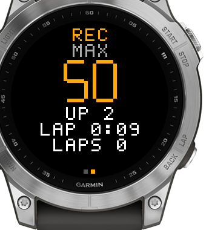
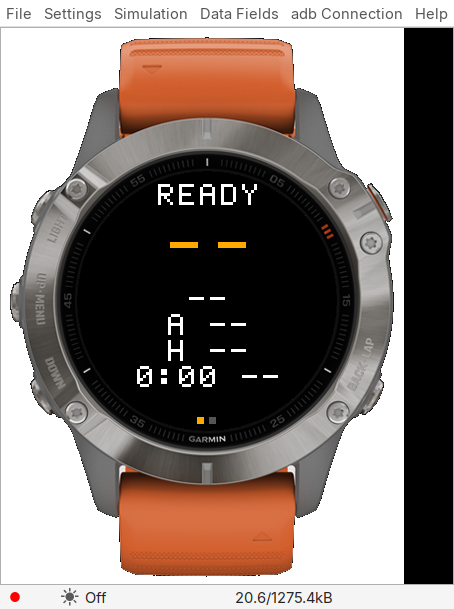

# MX Ride

Watch app for motocross and desert riding. Version 1.0.1. The big number is speed in km/h. Under it: heading, altitude, heart rate, timer, and distance. DOWN opens max speed, total ascent, and the lap timer.

Devices: fēnix 6, 6S, 6 Pro, 6S Pro, and 6X Pro, plus the fēnix 7 family. Solar and Dual Power are the same product id as the matching non-solar watch in SDK 9.3.0. There is no separate `fenix6x` id; the 6X is `fenix6xpro`. fēnix 7X is also Enduro 2 and tactix 7.






## Build

Connect IQ SDK 9.3.0. `monkeyc` must be on `PATH`, or set `CIQ_SDK` to the SDK root. Device definitions go in `~/.Garmin/ConnectIQ/Devices`.

The SDK zip does not need a Garmin login. The SDK manager's device download does. These binaries were built with the device files from [berryk/Garmin-watchface `devices-v1.0.0`](https://github.com/berryk/Garmin-watchface/releases/download/devices-v1.0.0/connectiq-devices.zip). Unpack it so these folders sit next to each other:

`fenix6` `fenix6s` `fenix6pro` `fenix6spro` `fenix6xpro` `fenix7` `fenix7s` `fenix7x` `fenix7pro` `fenix7spro` `fenix7xpro` `fenix7pronowifi` `fenix7xpronowifi`

```
./scripts/build.sh
```

Outputs:

- `bin/mxride-fenix6.prg`
- `bin/mxride-fenix6s.prg`
- `bin/mxride-fenix6pro.prg`
- `bin/mxride-fenix6spro.prg`
- `bin/mxride-fenix6xpro.prg`
- `bin/mxride-fenix7.prg`
- `bin/mxride-fenix7s.prg`
- `bin/mxride-fenix7x.prg`
- `bin/mxride-fenix7pro.prg`
- `bin/mxride-fenix7spro.prg`
- `bin/mxride-fenix7xpro.prg`
- `bin/mxride-fenix7pronowifi.prg`
- `bin/mxride-fenix7xpronowifi.prg`
- `bin/mxride.iq`

The first run mints `bin/developer_key.der` with openssl when that file is missing. The key and `bin/developer_key.pem` are gitignored. The `.prg` files already in `bin/` were signed with a key that is not in this repo. To rebuild those same signatures, put your own `developer_key.der` in `bin/` before running the script. A different key is a different signature: remove the old sideload from the watch before installing the new one.

## Sideload

Plug the watch in over USB. Copy the `.prg` that matches the product into `GARMIN/APPS` on the watch drive. Eject, then start MX Ride from the app list.

`bin/mxride.iq` is the package for Garmin Express or the store. USB sideload uses the `.prg`.

## Buttons

Physical buttons. Touch is not the control.

| Button | Action |
| --- | --- |
| START, short | Ready: start. Recording: pause. Paused: resume. Save screen: accept the highlighted choice. |
| START, long, or MENU | Pause if a session is recording, then open SAVE / DISCARD. |
| UP / DOWN | Switch the two pages. On the save screen, move the highlight. |
| BACK | Recording or paused: lap. Save screen: back to paused. Ready: leave the app. |

Page 1 is speed in km/h, heading in degrees plus a cardinal and a needle, `A` for altitude in meters, `H` for heart rate, then the timer and distance in km.

Page 2 is `MAX` speed, `UP` for total ascent in meters, the current lap time, and the lap count.

Missing GPS or heart rate draws `--`. Speed stays `--` until there is a fix. A zero is not used as a stand-in.

## What is recorded

The session is sport motorcycling, name Motocross. On Connect IQ 4.1.6 and later the subsport is motocross. fēnix 6 is API 3.4, which has no motocross subsport, so that field is left off and the sport stays motorcycling. The FIT gets the GPS track, speed, distance, elevation, ascent, timer, laps, heart rate when the watch has a reading, and the device's own calorie figure. Two developer fields, both in km/h: `max_speed` on the session, `lap_max_speed` on each lap.

GPS asks for SatIQ only when `hasConfigurationSupport` says the watch has that configuration. Otherwise it uses a continuous fix. fēnix 6 does not advertise SatIQ, so it takes the continuous path. The app does not pin multi-band max accuracy. `createSession` does not expose the recording interval, so 1 Hz versus smart recording stays with the device. The calorie number is the device algorithm. On a motorcycling activity that can be a poor estimate, because the bike is doing the work.

Screens are 240 (6S, 6S Pro, 7S, 7S Pro), 260 (6, 6 Pro, 7, 7 Pro), and 280 (6X Pro, 7X, 7X Pro). The same layout scales the line step for the 240 face. fēnix 6 and 6S have a 128 KB watch-app limit. The Pro and 6X Pro parts have 1.25 MB, and the fēnix 7 parts have 768 KB.

## Fonts

The official Connect IQ font pack returned HTTP 401 without a Garmin developer login. Asking the simulator for a missing system font crashes the app. MX Ride ships its own bitmap fonts in `resources/fonts`: a large 7-segment digit face and a smaller label face. `scripts/gen_fonts.py` regenerates both. Labels stay uppercase. That face has no lowercase and no degree sign.

## Simulator

`sim/desert-loop.gpx` is a two-minute rectangle at 50 km/h. With that file playing on the fēnix 7 simulator, the ride page showed 50 km/h, heading north, a running timer, and 0.1 km. The stats page showed a max of 50 and `UP 2`. That 2 m is the simulator's own ascent from a bad altitude series, not the climb in the file. The same run reported altitude near -450 m and no heart rate. This simulator did not apply the file's elevation or its heart-rate extension. The app drew the numbers the simulator supplied.

A later save on that same fēnix 7 run wrote a FIT with sport 22, subsport 36, GPS records, two laps, and both developer fields. Heart rate was absent and the altitude was the simulator's bad series. The 240 and 280 faces share the layout math and were compiled, not screenshotted. The non-sapphire simulator profile does not advertise SatIQ, so that run used a continuous fix.
